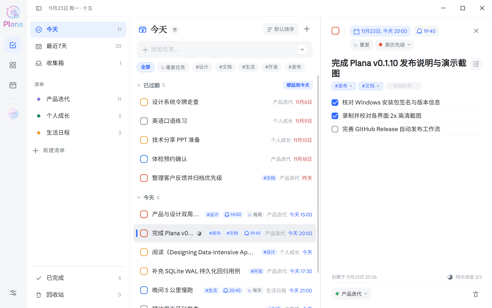
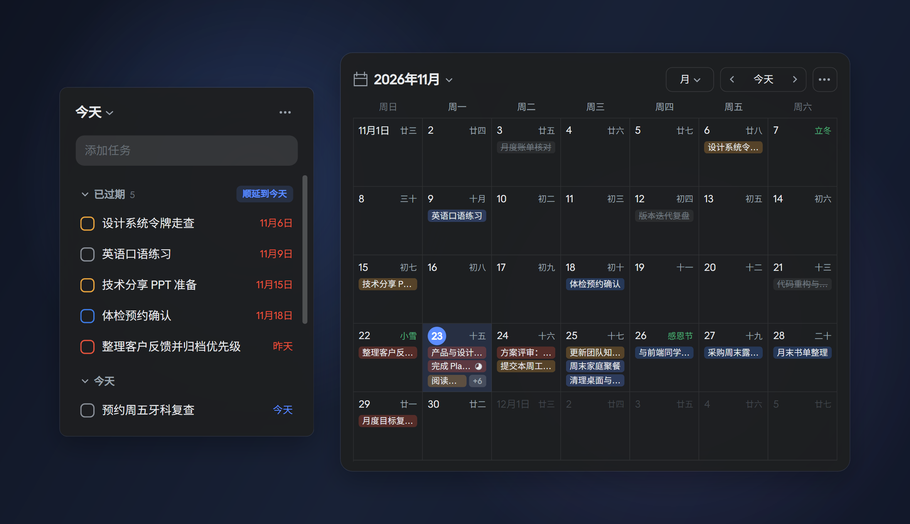
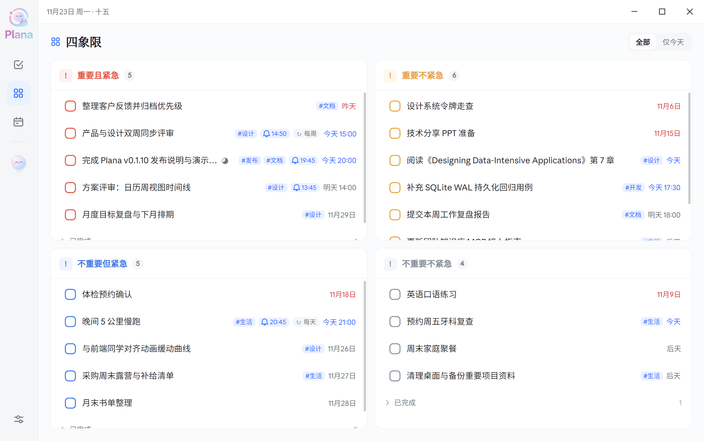
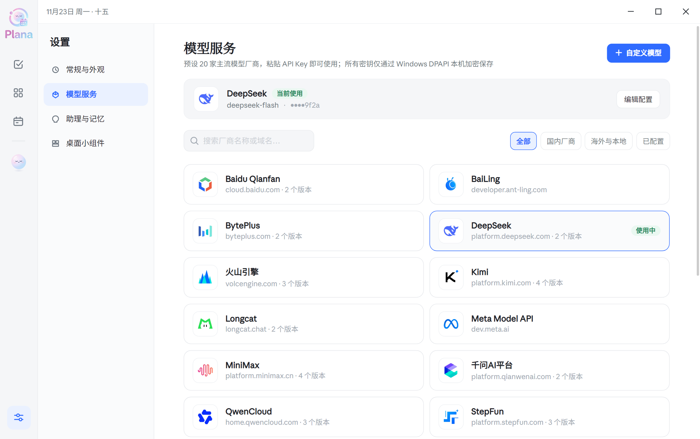

<div align="center">


<br />


### 原生轻量、本地优先的桌面任务、日程与 AI 规划工作台

把「今天要做什么」放在桌面上——一眼可见、一键可改、随时可撤。

<p>
  <a href="README.md"><strong>简体中文</strong></a> ·
  <a href="README_EN.md">English</a> ·
  <a href="https://github.com/s0ng1v/Plana/releases/latest"><strong>下载最新版 (v0.1.10)</strong></a> ·
  <a href="CHANGELOG.md">更新日志</a>
</p>

<p>
  <a href="https://github.com/s0ng1v/Plana/releases/latest"></a>
  <a href="LICENSE"></a>
  
  
  
</p>

<br />



</div>

---

## ✨ 为什么选择 Plana？

- **真正原生，拒绝套壳**：基于 **.NET 10 + Avalonia 12 + SkiaSharp** 编写，无 Electron / WebView 嵌套开销；内置助理程序集按需懒加载，未打开助理时保持极致轻量。
- **本地优先，隐私可控**：所有任务、子待办、规则、记忆与对话记录全部存储在本地 **SQLite (WAL)** 中；Windows 下 API Key 经 **DPAPI** 加密保存；无云端账号强制绑定、无遥测上报。
- **桌面小组件与全窗实时同步**：**今日日程小组件**与**月历小组件**均采用无边框透明工具窗口（不占用任务栏与 `Alt+Tab`），与主窗口共享同一仓储——任一处勾选、改期或新建，所有窗口毫秒级同步。
- **内置离线中文历法**：随程序分发 1901–2100 年农历、二十四节气、法定节假日与传统节日数据，同时内置离线中文自然语言日期解析（「下周三交周报」「后天下午开会」「月底前续费」实时识别，不消耗 Token）。
- **AI 日程写操作可预览、可细粒度撤销**：Lana 助理与外部 MCP 工具对日程的所有写入均纳入 `ChangeSet` 变更集，支持**单条撤销、多选撤销与整批撤销（`Ctrl+Z`）**。
- **双主题与内嵌字体栈**：提供 **经典蓝白 (`ClassicBlue`)** 与 **Plana 淡粉樱雾 (`Plana`)** 两套主题即时切换，并随包内嵌 `Anthropic Sans / Serif / Mono` 与字重重定基的 `Noto Sans SC / Noto Serif SC`，在不同机器上保持统一排版质感。

---

## 🖼️ 界面预览（v0.1.10 实机渲染）

### 1. 今日日程 + 月历桌面小组件（独立工具窗口，透明可调）



- 支持 **40%–100% 透明度调节**、**80%–200% 尺寸缩放**、位置与尺寸锁定、鼠标点击穿透（托盘菜单一键应急解除）。
- 今日小组件顶部自动汇总「已过期」未完成任务，支持一键「顺延到今天」；月历小组件支持单击任意日期展开窗内当日日程浮层、农历/节气切换与快捷新建。

### 2. Lana 智能日程助理与舞台级 Skia 动效

<table>
  <tr>
    <td width="50%">
      
      <p align="center"><sub><strong>对话与可撤销日程卡片</strong>（经典蓝白主题）：流式工具进度、自适应 Markdown 表格、卡片内直接调优先级/提前与反复提醒，支持单条/多选/整批撤销</sub></p>
    </td>
    <td width="50%">
      
      <p align="center"><sub><strong>Plana 淡粉樱雾主题</strong>：Skia 五态活体 Lana（<code>Sleep / Idle / Listening / Thinking / Happy</code>）、全窗鼠标视线跟随与动态时间农历问候</sub></p>
    </td>
  </tr>
</table>

### 3. 四象限矩阵 · 月/周双视图日历 · 20 家模型服务

<table>
  <tr>
    <td width="33.3%">
      
      <p align="center"><sub><strong>四象限矩阵</strong>：优先级自动映射四象限，支持跨象限拖拽改优先级与侧向悬浮编辑卡</sub></p>
    </td>
    <td width="33.3%">
      
      <p align="center"><sub><strong>月 / 周视图日历</strong>：离线农历、节气与节日标注，任务条支持拖拽改期与悬浮快速新建</sub></p>
    </td>
    <td width="33.3%">
      
      <p align="center"><sub><strong>20 家模型服务 + Ollama</strong>：官方目录与图标、多接入点切换、连接测试与自定义 URL</sub></p>
    </td>
  </tr>
</table>

---

## 🧩 核心功能一览

<details open>
<summary><strong>任务与清单工作台</strong></summary>

- **智能视图与自定义清单**：内置「今天」「最近 7 天」「收集箱」「已完成」「回收站（软删保留 30 天，支持恢复与彻底清除）」，支持自由创建、重命名与管理自定义清单。
- **高效筛选与排序**：支持按默认 / 优先级 / 日期排序，支持多 `#标签` 筛选与「仅看重复任务」快捷过滤。
- **完整任务属性**：支持子待办进度追踪（含列表饼图指示）、`HH:mm` 具体时刻、提前任意分钟提醒与按间隔反复提醒（Windows 原生通知）、以及 6 种重复规则（每天 / 工作日 / 每周 / 每月 / 每年 / 农历每年）。
- **数据备份与迁移**：支持 **JSON** 完整备份、**Markdown** 清单与标准 **RFC 5545 (`.ics`)** 日历导入导出（导入生成可撤销变更集）。

</details>

<details>
<summary><strong>Lana 智能助理与本地记忆系统</strong></summary>

- **多模态与 `@` 附件引用**：支持拖入或粘贴图片、截图、PDF、Word (`.docx`)、Excel (`.xlsx`)、PowerPoint (`.pptx`)、`.ics` 日历、HTML、EPUB、RTF、JSON/CSV 及主流代码/文本文件（单条消息最多 5 个、单个 ≤ 20 MB）；输入框输入 `@` 可精准引用已附加文件。
- **多轮工作流与历史编辑**：支持流式生成、停止、重试、重新生成同步截断持久化历史、悬停就地编辑历史用户消息及附件，以及新会话首条消息并行自动生成会话标题。
- **规则、画像与周复盘**：可在「设置 → 助理与记忆」配置每日任务/高优数量上限、休息日偏好、各操作自动执行权限（删除任务默认需确认），查看并编辑本地可读 `profile.md`（保留历史版本快照）、记忆列表与周复盘建议。

</details>

<details>
<summary><strong>外部 AI 接入（本地 MCP 服务）</strong></summary>

- 随包提供独立轻量的 **`VGList.Mcp`** stdio 代理进程，通过当前用户专属命名管道（Windows `\\.\pipe\plana-mcp-<SID>`，ACL 仅限当前用户）与主进程通信，默认关闭。
- 在「设置 → 助理与记忆 → 外部 AI 接入」开启后，可让 **Claude Desktop / Cursor / Antigravity / Codex** 等工具安全读写 Plana 日程（支持只读模式、限流、危险操作应用内弹窗确认与脱敏审计日志）。
- 点击设置页「复制配置」即可获得标准 `mcpServers` JSON，示例格式如下：

```json
{
  "mcpServers": {
    "plana": {
      "command": "<Plana 安装目录>/VGList.Mcp.exe",
      "args": []
    }
  }
}
```

</details>

---

## 📦 下载与安装

前往 **[GitHub Releases](https://github.com/s0ng1v/Plana/releases/latest)** 下载对应平台安装包：

### Windows 10 / 11 (x64)（主力支持）
- **安装版（推荐）**：下载 `Plana-Setup-0.1.10.exe` 运行即可。
  - 免管理员权限安装至当前用户目录；
  - 后续版本覆盖安装会自动沿用路径、结束托盘旧进程并完整保留任务数据库、设置、模型配置与 Lana 记忆。
- **绿色便携版**：下载 `Plana-win-x64-portable-0.1.10.zip` 解压后运行 `VGList.exe`。

### macOS（预览体验版）
- **Apple Silicon (M1 / M2 / M3 / M4)**：下载 `Plana-mac-arm64-0.1.10.zip`。
- **Intel Mac**：下载 `Plana-mac-x64-0.1.10.zip`。
- 解压后保持 `Plana.app`、`首次运行.command` 与 `安装说明.txt` 在同一目录，**双击（或右键 → 打开）`首次运行.command`**，脚本会自动清除隔离属性并完成本地 ad-hoc 签名后启动。

> **macOS 预览版提示**：当前未做 Apple Developer ID 签名与公证；系统通知通过脚本触发；开机自启、点击穿透与剪贴板图片/文件粘贴暂未在 macOS 端实现。完整特性建议优先使用 Windows 版。

---

## 🛠️ 本地构建与打包

### 环境要求
- [.NET 10 SDK](https://dotnet.microsoft.com/download/dotnet/10.0)（`10.0.x`）
- （可选）Windows 安装包打包需 [Inno Setup 6](https://jrsoftware.org/isinfo.php)
- （可选）macOS 打包需在 macOS 下使用自带的 `sips`、`iconutil`、`codesign`、`ditto`

### 常用命令

```powershell
# 1. 还原与构建（Windows）
dotnet restore VGList.slnx
dotnet build src/VGList.Desktop/VGList.Desktop.csproj -c Release -f net10.0-windows --no-restore

# 2. 运行主程序（开发调试）
dotnet run --project src/VGList.Desktop/VGList.Desktop.csproj -f net10.0-windows

# 3. 运行单元测试
dotnet test tests/VGList.Tests/VGList.Tests.csproj -c Release

# 4. 打包 Windows 安装程序（输出至 dist/Plana-Setup-0.1.10.exe）
pwsh -NoProfile -ExecutionPolicy Bypass -File scripts/build-installer.ps1 -Version 0.1.10
```

在 macOS 上构建双架构预览包：

```bash
chmod +x scripts/build-macos.sh
bash scripts/build-macos.sh 0.1.10
```

---

## 🗂️ 工程结构与本地数据目录

| 工程 / 目录 | 职责 |
|---|---|
| `src/VGList.Core` | 领域模型、重复规则、提醒计算、离线中文历法（无 UI / IO 依赖） |
| `src/VGList.Data` | SQLite (WAL) 仓储、顺序迁移与 `ChangeSet` 变更撤销引擎 |
| `src/VGList.App` | 用例服务、设置/模型配置存储、规则/记忆/画像、MCP 桥接 |
| `src/VGList.Agent` | Lana 助理内核（`Microsoft.Extensions.AI`、OpenAI/Anthropic 客户端、工具、附件解析） |
| `src/VGList.Widgets` | `WidgetHost`、今日日程小组件、月历小组件、主题令牌与内置字体集 |
| `src/VGList.Desktop` | 主窗口工作台、四象限、日历、设置页、Skia 活体 Lana 与托盘管理 |
| `src/VGList.Mcp` | 独立 `stdio` MCP 代理进程（命名管道转发至主进程） |
| `src/VGList.Platform*` | 跨平台抽象与 Windows / macOS 系统集成实现 |
| `tests/VGList.Tests` | xUnit 单元与集成回归测试套件 |

**本地数据存储位置**（软件卸载或覆盖安装均不会删除）：
- **Windows**：`%LOCALAPPDATA%\VGList\`（包含 `plana.db`、`settings.json`、`models.json`、`assistant\`、`mcp\`）
- **macOS**：`~/.local/share/VGList/`

---

## ⌨️ 常用快捷键

| 快捷键 | 功能 |
|---|---|
| `Ctrl + 1` / `2` / `3` / `4` | 切换「任务 / 四象限 / 日历 / Lana 助理」页面 |
| `Ctrl + J` | 快速打开 Lana 助理页面 |
| `Ctrl + ,` | 打开设置页 |
| `Ctrl + B` | 折叠 / 展开左侧清单栏 |
| `Ctrl + N` | 聚焦任务页快速添加框 |
| `Ctrl + Z` | 撤销最近一次 Lana / MCP 日程变更集（焦点不在输入框时） |
| `Tab` | 在任务录入框内循环切换优先级 |
| `Esc` | 关闭当前弹层 / 抽屉 / 详情面板 |

---

## 📄 开源协议与第三方声明

- 本项目源码采用 **[MIT License](LICENSE)** 开源协议。
- **内置字体声明**：
  - `Noto Sans SC` 与 `Noto Serif SC` 遵循 [SIL Open Font License 1.1](https://openfontlicense.org/) 开源协议随程序分发。
  - `Anthropic Sans / Serif / Mono` 为 Anthropic PBC 版权字体文件，仅随安装包作为排版字体资源使用，不适用本项目 MIT 代码授权条款的再授权。
- **第三方厂商标识**：`Assets/Providers/` 目录中的模型服务商 Logo 仅用于在设置页直观标识对应官方接入厂商，相关商标与品牌权益归各自所有者所有。
