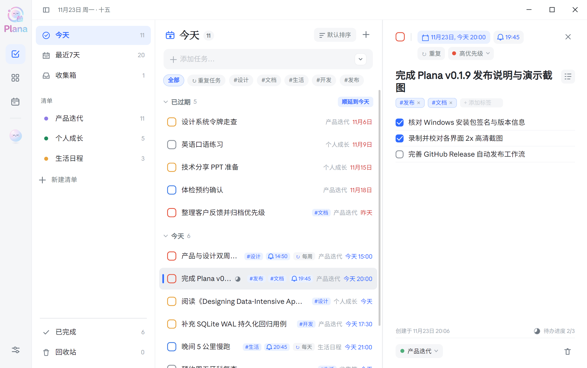
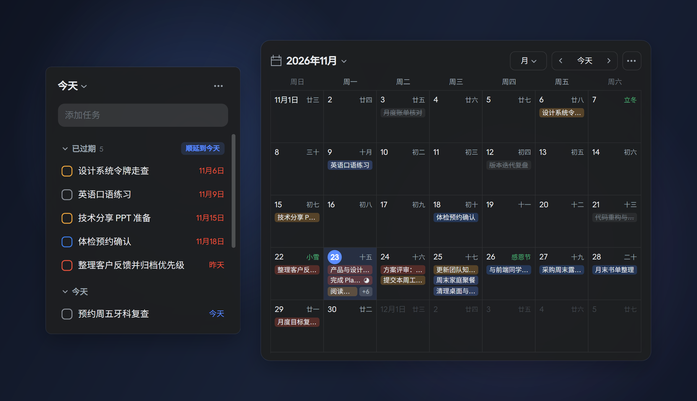
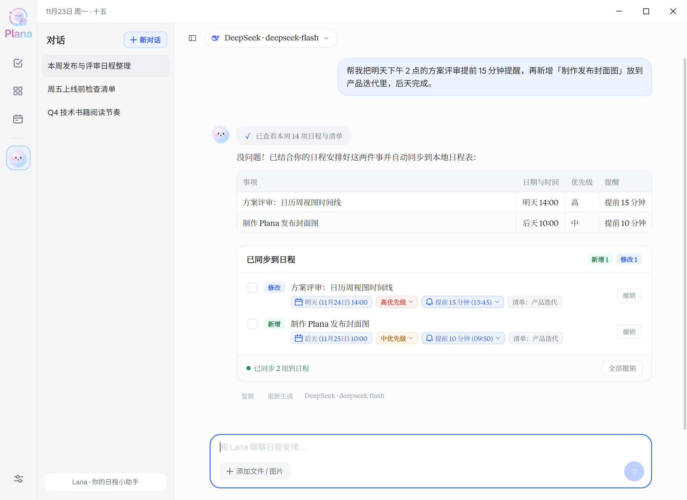
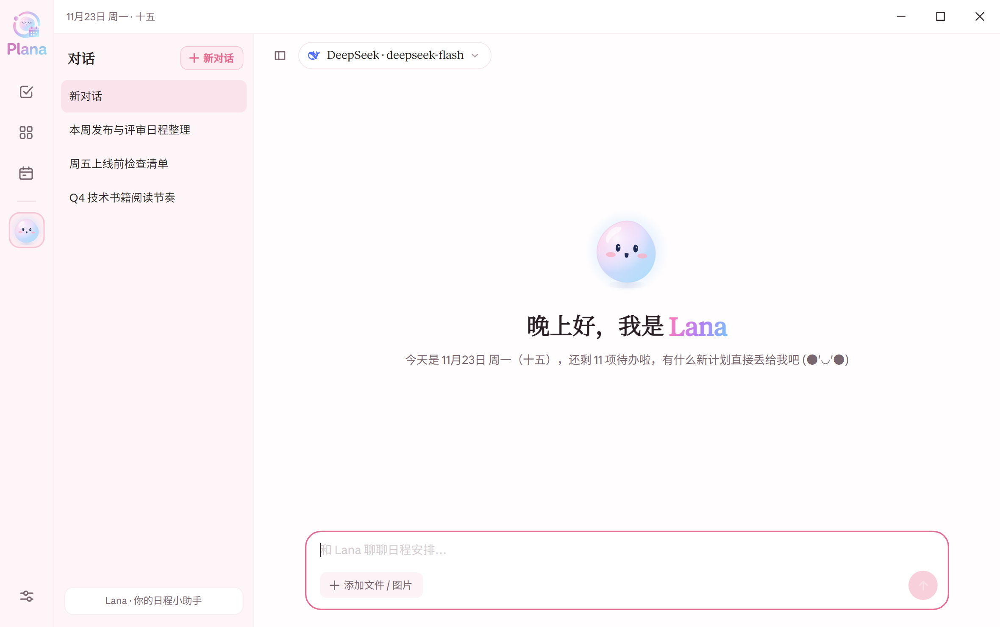
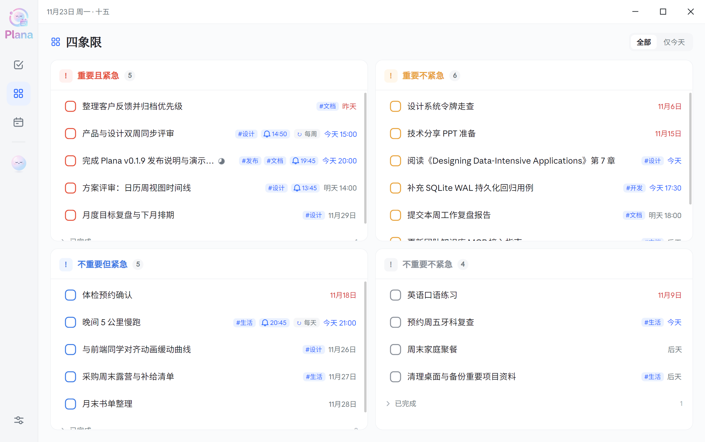
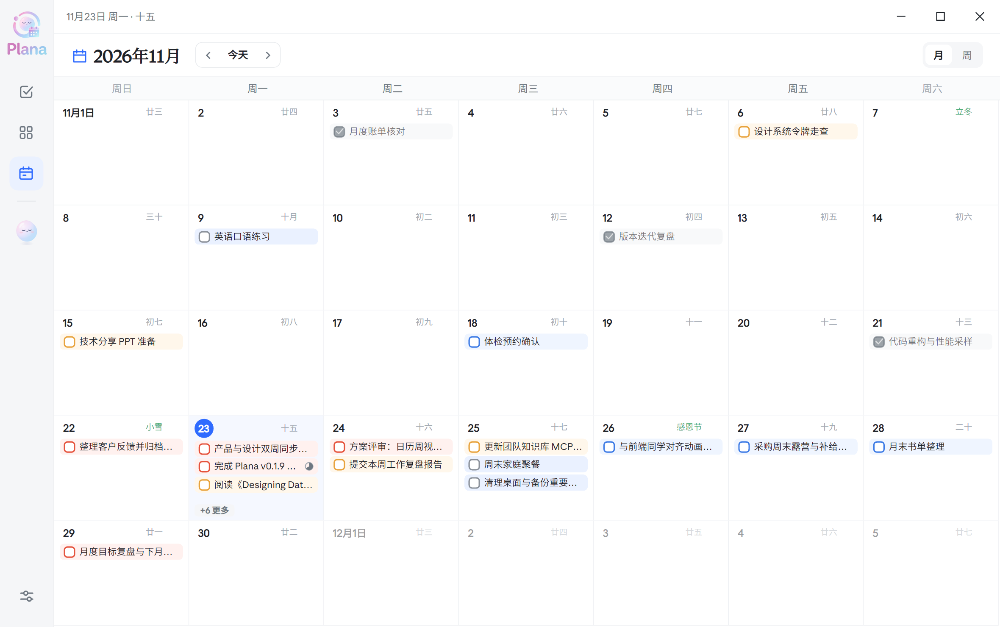
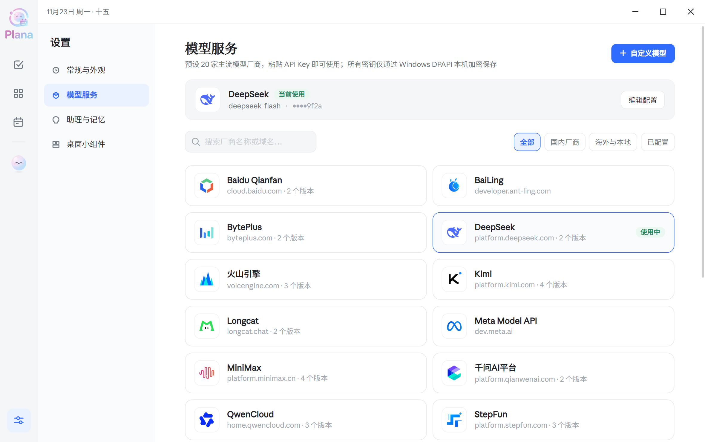

<div align="center">


<br />


### Native, Local-First Desktop Tasks, Calendar Widgets & AI Schedule Assistant

Keep what matters today right on your desktop — visible at a glance, editable in one click, always undoable.

<p>
  <a href="README.md">简体中文</a> ·
  <a href="README_EN.md"><strong>English</strong></a> ·
  <a href="https://github.com/s0ng1v/Plana/releases/latest"><strong>Download Latest (v0.1.9)</strong></a> ·
  <a href="CHANGELOG.md">Changelog</a>
</p>

<p>
  <a href="https://github.com/s0ng1v/Plana/releases/latest"></a>
  <a href="LICENSE"></a>
  
  
  
</p>

<br />



</div>

---

## ✨ Highlights

- **Truly Native Desktop App**: Built with **.NET 10 + Avalonia 12 + SkiaSharp** — zero Electron or WebView overhead. The AI assistant assembly is strictly lazy-loaded so startup and idle footprints remain ultra-light.
- **Local-First & Private**: Tasks, subtasks, rules, memories, and chat history live locally in **SQLite (WAL)**. API keys are encrypted on Windows via **DPAPI**. No mandatory cloud account, no telemetry.
- **Live-Synced Desktop Widgets**: Borderless transparent **Today** and **Month** desktop tool windows (hidden from taskbar & `Alt+Tab`) share the exact same repository as the main window — changes sync across every window instantaneously.
- **Built-in Offline Chinese Calendar & NL Dates**: Ships offline 1901–2100 lunar dates, 24 solar terms, and public/traditional holidays alongside an offline Chinese natural-language date parser (zero token cost).
- **Undoable AI Scheduling**: Every schedule change applied by the Lana assistant or an external MCP client records a `ChangeSet`, supporting **per-item, multi-select, and full-batch undo (`Ctrl+Z`)**.
- **Dual Themes & Embedded Typography**: Switch live between **Classic Blue (`ClassicBlue`)** and **Plana Cherry Pink (`Plana`)**, backed by bundled typography resources (`Anthropic Sans / Serif / Mono` + re-baselined `Noto Sans SC / Noto Serif SC`).

---

## 🖼️ Screenshots (v0.1.9)

### Desktop Today & Month Widgets



### Lana AI Assistant & Dual Themes

<table>
  <tr>
    <td width="50%">
      
      <p align="center"><sub><strong>Lana Chat & Undoable Schedule Cards</strong> (Classic Blue): streaming tool progress, responsive Markdown tables, inline priority/reminder tuning, and granular undo</sub></p>
    </td>
    <td width="50%">
      
      <p align="center"><sub><strong>Plana Cherry-Pink Theme</strong>: 5-state Skia-rendered live Lana avatar (<code>Sleep / Idle / Listening / Thinking / Happy</code>) with window-wide gaze tracking</sub></p>
    </td>
  </tr>
</table>

### Eisenhower Matrix · Calendar · 20 Model Providers

<table>
  <tr>
    <td width="33.3%">
      
      <p align="center"><sub><strong>Eisenhower Matrix</strong>: 1-to-1 priority quadrant mapping with drag-and-drop reprioritization and floating edit cards</sub></p>
    </td>
    <td width="33.3%">
      
      <p align="center"><sub><strong>Month / Week Calendar</strong>: offline lunar & solar-term annotations, drag-to-reschedule chips, and quick-create popovers</sub></p>
    </td>
    <td width="33.3%">
      
      <p align="center"><sub><strong>20 Providers + Local Ollama</strong>: curated presets (DeepSeek, Anthropic, OpenAI, Gemini, Kimi, Zhipu, Qwen, etc.) and custom OpenAI/Anthropic URLs</sub></p>
    </td>
  </tr>
</table>

---

## 📦 Installation

Download the latest release binaries from **[GitHub Releases](https://github.com/s0ng1v/Plana/releases/latest)**:

- **Windows 10 / 11 (x64)**:
  - Run `Plana-Setup-0.1.9.exe` (user-level Inno Setup installer, no admin required; seamlessly upgrades while preserving `%LOCALAPPDATA%\VGList\`), or extract `Plana-win-x64-portable-0.1.9.zip` and launch `VGList.exe`.
- **macOS (Preview)**:
  - Download `Plana-mac-arm64-0.1.9.zip` (Apple Silicon) or `Plana-mac-x64-0.1.9.zip` (Intel).
  - Extract the archive and double-click (or right-click → Open) `首次运行.command` to clear quarantine attributes, apply ad-hoc signing, and launch `Plana.app`. *(Note: macOS preview builds are unsigned/unnotarized; full feature parity such as click-through widgets and native notification click-back is prioritized on Windows.)*

---

## 🛠️ Build from Source

Requires **.NET 10 SDK** (`10.0.x`).

```powershell
# Restore & build on Windows
dotnet restore VGList.slnx
dotnet build src/VGList.Desktop/VGList.Desktop.csproj -c Release -f net10.0-windows --no-restore

# Run unit tests
dotnet test tests/VGList.Tests/VGList.Tests.csproj -c Release

# Build Windows installer (requires Inno Setup 6)
pwsh -NoProfile -ExecutionPolicy Bypass -File scripts/build-installer.ps1 -Version 0.1.9
```

On macOS:

```bash
chmod +x scripts/build-macos.sh
bash scripts/build-macos.sh 0.1.9
```

---

## 📄 License & Third-Party Notices

- Source code is licensed under the **[MIT License](LICENSE)**.
- Bundled `Noto Sans SC` and `Noto Serif SC` fonts are distributed under the [SIL Open Font License 1.1](https://openfontlicense.org/).
- Bundled `Anthropic Sans / Serif / Mono` font files carry Anthropic PBC copyright and are included solely as embedded UI font assets rather than re-licensed under MIT.
- Third-party provider logos in `src/VGList.Desktop/Assets/Providers/` remain the trademarks of their respective owners and are used strictly for provider identification in Settings.
