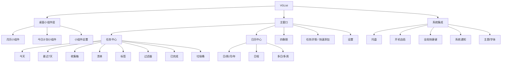
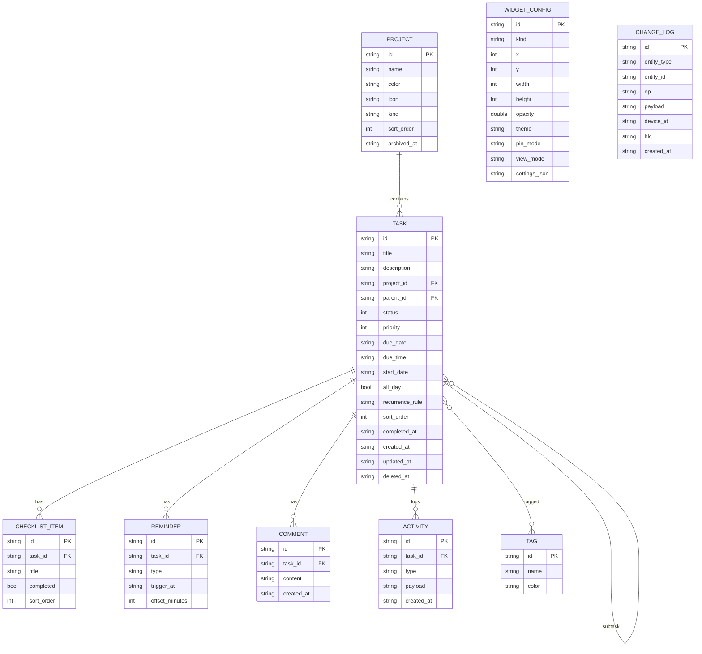

# VGList 基本蓝图

> 版本：v0.1（调研版）
> 日期：2026-11-16
> 定位：本地优先的轻量桌面任务管理软件，首发 Windows，形态对标滴答清单桌面端
> 本阶段范围：桌面小组件（月历 / 今日计划）+ 任务 + 日历 + 四象限

---

## 1. 产品定位

| 项 | 结论 |
|---|---|
| 一句话 | 把「今天要做什么」放在桌面上，一眼可见、一键可改的轻量任务软件 |
| 目标用户 | 需要桌面常驻待办视图、重视效率与视觉质感的重度个人用户 |
| 差异化 | 小组件体验做到与主程序同等精致；本地优先、无账号可用、冷启动快、内存低 |
| 非目标（P0） | 团队协作、习惯打卡、番茄专注、笔记体系、云端账号 |

### 设计原则

1. **桌面即入口**：小组件不是附属功能，而是第一等公民，拥有独立交互与设置。
2. **本地优先**：无网络可用；所有数据落在本地 SQLite；同步是后续增量能力而非前提。
3. **轻**：内存 ≤ 150MB（5000 任务），冷启动 ≤ 1.2s，动画 60fps，不做后台轮询。
4. **中文日历友好**：农历、节气、节日、周起始日可配，是基础能力而非插件。
5. **视觉统一**：主窗口与小组件共用同一套设计令牌（颜色 / 圆角 / 间距 / 字体 / 动效）。

---

## 2. 竞品调研结论（滴答清单 Windows 桌面端）

> 调研方式：Computer Use 实机观察，覆盖主窗口、两个桌面小组件、任务详情、快速添加、日期选择、日历视图菜单与显示设置。

### 2.1 窗口拓扑（实测尺寸）

| 窗口 | 实测尺寸 | 性质 |
|---|---|---|
| 主窗口「滴答清单」 | 1104 × 706 | 主界面，左侧栏 + 列表 + 右侧详情面板 |
| 月历小组件「GridWidget」 | 662 × 544 | 独立无边框窗口，可拖动/缩放 |
| 任务小组件「任务小部件」 | 331 × 454 | 独立无边框窗口，竖长比例 |
| 快速添加 | 788 × 198 | 独立浮层，仅一行输入 + 属性按钮 |
| 任务详情（独立窗口模式） | 505 × 429 | 也可内嵌为右侧面板 |

结论：小组件是**独立顶层窗口**，不是贴图；这意味着 VGList 需要一套「多窗口 + 无边框 + 置顶/贴桌面」的窗口管理能力。

### 2.2 主窗口信息架构

- 左侧栏：`今天` / `最近 7 天` / `收集箱` / `清单（欢迎）` / `标签` / `过滤器` / `已完成` / `垃圾桶`
- 中间：任务列表（顶部 `+ 添加任务`，任务行，底部「已完成 N」折叠分组）
- 右侧：任务详情面板（点击任务行展开）
- 顶部：筛选 / 排序 / 更多；右上角进入「日历」

### 2.3 任务模型（从 UI 反推）

任务 = 复选框 + 标题 + 日期（可空）+ 优先级（无/低/中/高）+ 清单归属 + 标签 + 子任务 + 描述 + 评论/动态 + 提醒 + 重复 + 完成度 + 排序位。

详情面板字段顺序（自上而下）：圆形复选框 → 日期（「11月16日, 今天」）→ 优先级红旗 → 大标题 → 完成度 `0%` → 描述区 → 子任务图标 → 底部清单归属（收集箱）。

详情「…」菜单包含：任务动态 / 保存为模板 / 创建副本 / 复制链接 / 打开便签 / 转换为笔记 / 导出 / 打印 / 删除。

### 2.4 快速添加

一行标题输入（占位「准备做什么？」）+ 日期 `今天` + 优先级旗 + 标签 + 清单 + `…` + 添加按钮。核心是「不打断当前上下文即可录入」。

### 2.5 日期选择弹窗

- 顶部快速输入框（自然语言如「明天下午 3 点」）
- Tab：`日期` / `时间段`
- 月历（标注农历）
- 底部三个 Tab：`时间` / `提醒` / `重复`
- 底部按钮：`确定` / `清除`

### 2.6 日历

- 月视图：6 行网格；每格左上公历日、右上农历；任务以 chip 展示，约 4 条后折叠；今天高亮。
- 视图矩阵：`日 D` / `周 W` / `月 M` / `年 Y` / `日程 A` / `多日（主程序 7 天，小组件 5 天）` / `多周（2 周）`。
- 右上「…」：显示设置 / 安排任务 / 日历订阅 / 打印。
- 显示设置（10 项）：颜色、样式、显示周末、显示已完成、显示检查事项、显示所有重复周期、显示习惯、显示专注记录、显示倒数纪念日、辅助时区。

### 2.7 月历小组件

- 头部：`2026年11月` + `+`（新建）+ 视图下拉（`月 ▾`）+ 前后翻页 + `今天` 按钮
- 星期行：周日 → 周六
- 6 行 × 7 列日期格：大号公历日 + 小号农历 + 节日（如「立冬」「感恩节」用绿色强调）
- 今天：蓝色圆底反白
- 日期格内任务条：单行文本 chip，溢出显示 `+N`
- 支持拖动/缩放（四向箭头手柄），无「…」菜单（视图切换走下拉）

### 2.8 任务小组件（当日计划）

- 头部：`今天 ▾`（可切清单/日期范围）+ 右上 `…`
- 输入区：`添加任务`（可直接录入）
- 任务行：圆形复选框 + 标题 + 右侧日期（蓝色「今天」）
- 已完成分组：`今天 (1)` 折叠标题 + 数量；已完成项为勾选圆 + 删除线 + 灰色日期

### 2.9 四象限

- 2 × 2 卡片，各自带色与 `!` 图标：
  - 重要且紧急 — 红
  - 重要不紧急 — 黄
  - 不重要但紧急 — 蓝
  - 不重要不紧急 — 绿
- 卡片结构：标题栏 + `+` 新建 + `…` 菜单；内部按「今天 / 已完成 N」分组；独立滚动；底部「查看更多」跳转完整列表。
- **优先级 → 象限映射（实测推断，待产品确认）**：高 → 重要且紧急；中 → 重要不紧急；低 → 不重要但紧急；无 → 不重要不紧急。

### 2.10 可复用的结论

1. 小组件与主程序必须共享同一任务仓库与同一套状态（完成、改期立即双向反映）。
2. 「今天」是全局核心口径：主窗口首项、任务小组件标题、日历高亮、四象限分组均围绕它。
3. 优先级是四象限的唯一数据源，不额外维护「重要/紧急」两个布尔字段，避免双写不一致。
4. 视图切换密度高（7 种日历视图），需要统一的「时间轴视图引擎」而非 7 套独立实现。

---

## 3. 信息架构



---

## 4. 模块划分

### M1 桌面小组件层（P0 核心）

| 子模块 | 职责 |
|---|---|
| WidgetHost | 无边框窗口生命周期、拖动/缩放、位置尺寸持久化、DPI 适配、单实例、开机恢复 |
| 窗口模式 | `置顶` / `贴桌面（WorkerW）` / `普通`；透明度与主题独立配置 |
| 月历小组件 | 年月标题、翻页、今天、星期行、6×7 网格、农历/节气/节日、任务 chip 与 `+N` 折叠、`+` 新建 |
| 今日计划小组件 | 日期范围切换（今天/最近 7 天/指定清单）、内联添加、任务行（复选 + 标题 + 日期）、已完成折叠分组 |
| 小组件设置 | 视图模式、主题（浅/深/跟随）、透明度、缩放、显示项（周末/已完成/农历/节日）、锁定位置 |

关键规则：小组件内完成/编辑任务，主窗口即时反映（共享仓储 + 变更事件总线上报）。

### M2 任务中心

- 视图：今天、最近 7 天、收集箱、清单（含文件夹分组）、标签、过滤器、已完成、垃圾桶。
- 列表能力：新增（行内）、编辑、完成/取消完成（含短暂撤销）、删除/恢复、拖拽排序、多选批量、优先级/日期/标签快速修改。
- 排序与筛选：按日期/优先级/创建时间/自定义；按清单/标签/状态/关键词过滤；顶部筛选与排序入口。
- 已完成分组：列表底部折叠，显示数量。

### M3 日历中心

- 时间轴视图引擎：日 / 周 / 月 / 年 / 日程 / 多日 / 多周共用一套数据管道（时间区间 → 任务集合 → 布局策略）。
- 月视图：6 行网格、农历/节日角标、任务 chip、今天高亮、跨天任务条。
- 周/日视图：时间轴 + 全天区，任务按时间段落位。
- 日程视图：按日分组的清单式列表。
- 交互：点击空白新建（带日期）、拖拽改期、拖拽改时长、跨视图保持滚动位置。
- 显示设置：周末、已完成、检查事项、重复周期、农历、节日、辅助时区（P0 先做前四项）。

### M4 四象限

- 数据源：任务优先级（高/中/低/无）一对一映射，不引入冗余字段。
- 布局：2×2 卡片，色 + `!` 图标；卡片内「今天」与「已完成 N」分组；独立滚动；`+` 新建（自动带入该象限默认优先级）；`…` 菜单（排序、隐藏空分组、显示已完成）；「查看更多」跳转对应筛选列表。
- 交互：卡片间拖拽任务 = 修改优先级（P1）。

### M5 任务详情与快速添加

- 详情：复选框、日期与时间段、优先级、标题、完成度、描述（Markdown 简版）、子任务、标签、清单归属、提醒、重复、评论/动态、`…` 更多。
- 快速添加：全局快捷键唤起，单行输入 + 日期 + 优先级 + 标签 + 清单，回车即存。
- 日期选择器：快速输入（自然语言，P1）、日期/时间段 Tab、月历带农历、时间/提醒/重复三个 Tab、确定/清除。

### M6 提醒与重复引擎

- 提醒：绝对时间 / 相对截止偏移；系统通知 + 声音；错过提醒的补偿策略。
- 重复：RRULE 子集（每天/每周/每月/每年/工作日/自定义间隔/结束条件）。
- 后台：随程序常驻（托盘），不做独立服务；开机自启可选。

### M7 数据与同步

- 本地：SQLite（WAL）+ 仓储层 + 迁移脚本；写操作全部走事务并同时写入变更日志（oplog）。
- 备份：手动导出/导入 JSON（P1）；每日自动快照（P1）。
- 同步（预留）：`SyncClient` 接口 + 游标拉取 / 批量推送 / 冲突按字段 LWW（HLC 时间戳）；P0 只写入 oplog，不发网络请求。
- 多端：手机端后续接入同一协议；服务端形态待定（自建轻量服务或托管后端）。

### M8 设置与系统集成

- 通用：开机自启、最小化到托盘、关闭行为、语言、周起始日。
- 外观：主题（浅/深/跟随系统）、强调色、字体大小、动效开关。
- 快捷键：全局快速添加、显示/隐藏主窗口、显示/隐藏小组件。
- 小组件管理：各小组件的显示开关、位置重置、默认视图。

---

## 5. 数据模型（P0）



约定：
- 时间统一存 UTC ISO-8601，展示时按本地时区换算；「全天」任务只存日期。
- 删除为软删除（`deleted_at`），垃圾桶保留 30 天后清理。
- `status`：0 未完成 / 1 已完成 / 2 已放弃（预留）。
- `priority`：0 无 / 1 低 / 2 中 / 3 高 —— 四象限直接由此映射。
- 变更日志与业务表在同一事务内写入，保证后续同步可回放。

---

## 6. 技术架构

### 6.1 选型结论

| 层 | 选型 | 理由 |
|---|---|---|
| 桌面 UI | **Avalonia 12（.NET 10 LTS + XAML）** | 原生窗口（多窗口、无边框、透明、置顶）能力最直接，内存与启动接近滴答清单；自绘能力强，能做高质感 UI |
| UI 风格 | Fluent 主题为基底 + 自研设计令牌层 | 保证小组件与主窗口视觉一致，避免"控件默认脸" |
| 数据 | SQLite（WAL）+ Microsoft.Data.Sqlite + Dapper | 轻、无服务、事务可控；不用重型 ORM |
| 平台互操作 | Win32 P/Invoke 独立工程 | WorkerW 贴桌面、亚克力/云母、热键、任务栏、通知 |
| 同步 | 自研 oplog + HLC，接口先留 | 本地优先，手机端接入时只补服务端与推送通道 |
| 移动端（后续） | 独立技术栈（Flutter / MAUI 待定） | 不强行复用 UI；复用数据模型与同步协议 |

不采用 Electron / Tauri 的理由：用户明确要求「软件不是 Web」；WebView 方案在常驻内存、启动速度与系统窗口集成上均劣于原生。

### 6.2 工程结构

```
VGList.sln
├─ src/
│  ├─ VGList.Core           领域模型、值对象、业务规则（无 UI、无 IO）
│  ├─ VGList.Data           SQLite 仓储、迁移、oplog
│  ├─ VGList.App            用例/服务层、事件总线、设置
│  ├─ VGList.Desktop        Avalonia 主窗口、视图、ViewModel
│  ├─ VGList.Widgets        小组件宿主与两个小组件视图
│  ├─ VGList.Platform.Win   Win32/系统集成
│  └─ VGList.Sync           SyncClient 接口与占位实现
└─ tests/
   ├─ VGList.Core.Tests
   └─ VGList.Data.Tests
```

依赖方向：`Desktop / Widgets → App → Core`，`App → Data → Core`，`Platform.Win` 只被 UI 层引用。

### 6.3 关键实现点

- **多窗口**：Avalonia 原生多 Window；每个小组件一个无边框窗口，`TransparencyLevelHint` 走亚克力/云母。
- **贴桌面**：通过 Win32 `FindWindow("Progman")` → `WorkerW` 重设父窗口；失败自动降级为「始终置顶」。
- **状态同步**：单一 `TaskRepository` + `INotificationBus`，任一窗口写入 → 全窗口刷新；禁止各窗口自行缓存任务集合。
- **列表性能**：虚拟化列表（仅渲染可视区），万级任务滚动不掉帧。
- **农历/节日**：内置离线数据表（1900–2100 农历 + 节气 + 法定节日），不依赖网络。
- **单实例**：命名互斥体；第二实例唤起主窗口。

### 6.4 性能预算

| 指标 | 目标 |
|---|---|
| 冷启动到可交互 | ≤ 1.2s（SSD） |
| 常驻内存（5000 任务，主窗 + 2 小组件） | ≤ 150MB |
| 小组件拖动 / 缩放 | 60fps，无重排卡顿 |
| 任务勾选到全窗口反映 | ≤ 50ms |
| 安装包 | ≤ 60MB |

---

## 7. 视觉与交互规范（摘要）

- 栅格：4px 基准，常用间距 8 / 12 / 16 / 24。
- 圆角：卡片 12，输入 8，小组件 16。
- 字体：`Segoe UI Variable` / 思源黑体；标题 15–17，正文 13–14，辅助 11–12。
- 语义色：今天/强调蓝；四象限 红 / 黄 / 蓝 / 绿（同色系深浅两档用于底与描边）。
- 动效：150–200ms ease-out；完成任务的勾选动画 + 行淡出，不做花哨转场。
- 空状态：每个视图必须有引导文案与「+ 新建」入口，不留纯白。
- 深色模式：与浅色同结构，仅替换令牌，不允许单独硬编码颜色。

---

## 8. 范围规划

### P0（首个可发布版本）

1. 主窗口骨架：左侧栏 + 任务列表 + 右侧详情面板 + 顶部工具栏。
2. 任务：收集箱 / 今天 / 最近 7 天；新增、编辑、完成、删除、优先级、日期、清单归属。
3. 任务详情与快速添加。
4. 月历小组件 + 今日计划小组件（含拖动、缩放、置顶、透明度、位置记忆）。
5. 日历：月视图 + 周视图（6 行网格、chip、今天高亮、点击新建、拖拽改期）。
6. 四象限：四卡布局、优先级映射、分组、`+` 新建、卡片内滚动。
7. 本地 SQLite、软删除、oplog 落库、设置（主题 / 开机自启 / 托盘 / 周起始日）。
8. 农历 / 节气 / 节日离线数据。

**验收标准（P0）**
- 在小组件勾选任务，主窗口 1 秒内同步显示为已完成。
- 主窗口改期后，月历小组件任务 chip 立即移动到新日期。
- 任意视图新增任务，默认落到当前视图上下文（日期/清单）。
- 连续添加 50 个任务，列表滚动保持 60fps。
- 重启后小组件位置、尺寸、置顶状态、视图模式全部恢复。

### P1

- 提醒（系统通知 + 声音）、重复规则、错过提醒补偿。
- 标签、过滤器、已完成/垃圾桶完整流程、批量操作、多选拖拽。
- 日历日/年/日程/多日/多周视图、日历显示设置完整 10 项。
- 四象限拖拽改优先级、卡片排序定制。
- 小组件设置面板、多显示器位置记忆、锁定位置。
- 自然语言日期输入、导出/导入 JSON、自动备份。

### P2

- 同步服务端 + 手机端（同一协议）。
- 子任务树、评论/动态时间线、模板、打印/导出。
- 清单文件夹、共享清单（若产品需要）。

---

## 9. 里程碑

| 阶段 | 交付物 | 出口条件 |
|---|---|---|
| M0 骨架 | 工程结构、设计令牌、主窗口壳、SQLite 与迁移 | 能启动、能建任务、能持久化 |
| M1 小组件 | WidgetHost + 月历 + 今日计划 | 两个小组件可拖动缩放置顶，数据双向同步 |
| M2 任务 | 任务中心 + 详情 + 快速添加 | P0 任务功能验收通过 |
| M3 日历与四象限 | 月/周视图、四象限 | 拖拽改期与优先级映射正确 |
| M4 打磨 | 动效、空状态、深色、性能达标 | 满足性能预算 |

---

## 10. 风险与待确认

| 风险 | 影响 | 应对 |
|---|---|---|
| WorkerW 贴桌面在不同 Windows 版本行为不一致 | 小组件无法真正"贴在桌面" | 失败降级为置顶；内部开关可切模式 |
| 多窗口 + 高 DPI 拖拽抖动 | 观感差 | 统一 DPI 换算层，缩放用整数插值 |
| 农历/节假日数据准确性与版权 | 显示错误或合规问题 | 使用公开算法与公开节日表，仅存节气/公历节日 |
| 提醒在程序退出后失效 | 用户漏事 | 托盘常驻 + 开机自启，文档明示 |
| 视觉打磨被功能挤占 | "好看"目标落空 | 设计令牌先行，M4 前不做功能扩张 |

待确认：
1. 四象限是否固定按优先级映射，还是允许手动拖拽并回写优先级（当前建议：允许，二者等价）。
2. 小组件是否需要"点击穿透"与"锁定"。
3. 移动端技术栈（Flutter / MAUI）与服务端形态（自建 / 托管）。
4. 是否需要账号体系；若纯本地，手机同步需局域网直连或自建服务。

---

## 附：调研证据（窗口与元素）

- 主窗口 `windowId=1903830`，1104×706；左侧栏 8 项；列表 + 详情面板 + 日历入口。
- 月历小组件 `GridWidget` `windowId=2560688`，662×544；标题「2026年11月」，视图下拉「月」，星期行周日起，6 行网格，任务条 4 条 + 溢出。
- 任务小组件「任务小部件」`windowId=787218`，331×454；标题「今天」，`添加任务` 输入，4 个任务行，已完成分组「今天 (1)」。
- 快速添加 `windowId=2359328`，788×198。
- 任务详情（独立）`windowId=1376288`，505×429。
- 显示设置窗口：10 个开关项（周末/已完成/检查事项/重复周期/习惯/专注记录/倒数纪念日/辅助时区/颜色/样式）。

---

## 11. P0 决策（Grill 结论 · 2026-11-16）

### 11.1 落地方式

| # | 决策项 | 结论 |
|---|---|---|
| 1 | 视觉基准 | 小组件像素级对齐；主窗口结构级 + 自有视觉 |
| 2 | 施工顺序 | 今日小组件 → 月历小组件 → 任务页 → 四象限 → 日历页 → 设置页 |
| 3 | 前端边界 | 页面 + 交互 + 内存假数据全真做；不接 SQLite、不做提醒；重启数据重置 |
| 4 | 技术栈 | Avalonia 11 + .NET 10 LTS（本机需先安装 SDK） |
| 5 | 验收方式 | 每页 checklist + 运行时截图存档（100% / 125% / 150% DPI） |

### 11.2 今日日程小组件规格

**窗口与材质**
- 基准尺寸 331 × 454；半透明亚克力，默认约 85% 不透明度，设置可调 60–95%。
- 默认深色主题（与截图一致），支持浅色；主窗口跟随系统主题。
- 默认「贴桌面」（WorkerW），设置可切「始终置顶」；无边框、可拖动、可缩放 80–200%、位置与尺寸持久化。
- 字体 Segoe UI Variable，回退 Microsoft YaHei UI；任务行高 44，单行输入框 40，圆角 16 / 10 / 8。

**添加任务输入框**
- 默认单行（约 40px），随文字自动增高，最高 5 行（约 120px），超出后框内滚动。
- 「今天 ▾」日期 chip：单行时在输入框内右侧；多行时沉到输入框右下角。
- 点 chip 弹轻量日历：今天 / 明天 / 后天快捷 + 月历 + 清除；P0 不含时间、提醒、重复。
- Enter 提交并清空，光标保持、优先级重置为「无」、日期沿用当前视图；Shift + Enter 换行。
- 空内容 Enter 不提交、不报错。

**优先级快捷条（本次新增需求）**
- 输入框获得焦点即在**输入框正上方**展开，悬浮覆盖标题行，任务列表不位移。
- 4 个圆钮横排：空心旗（无）/ 蓝旗（低）/ 黄旗（中）/ 红旗（高）；选中项加同色圆底，hover 显示「无 / 低 / 中 / 高」，不占位显示文字。
- 选完**保持展开**，直到失焦 / ESC / 点击外部才收起；展开期间标题行被覆盖，可接受。
- 输入框边框色 = 当前优先级色：无 → 聚焦品牌蓝、失焦灰；低 → 蓝；中 → 黄；高 → 红；失焦后保留优先级色但降饱和。
- 颜色只作用于边框，不改变文字、左侧 `+` 号与日期 chip 的颜色。
- 优先级属于草稿态：任务提交后输入框恢复默认，避免连续录入误标。

**P0 入口范围**：优先级快捷条 + 日期 chip。清单归属、标签、附件、模板、转换为笔记均为 P1；对应「⋯」菜单 P0 不实现。

### 11.3 主窗口

- 三栏：左栏（今天 / 最近 7 天 / 收集箱 / 清单 / 已完成）+ 中间任务列表 + 右侧详情面板（约 380px，可折叠）。
- 点任务行打开右侧详情；小组件点任务行 → 独立小窗，复用同一详情控件。
- P0 左栏不含垃圾桶、标签、过滤器。

### 11.4 P0 页面清单

1. 今日日程小组件（含 WidgetHost：拖动 / 缩放 / 层级 / 位置记忆）
2. 月历小组件（年月标题、翻页、今天、周日起 6×7、农历/节气/节日、任务 chip 与 `+N`）
3. 任务页（左栏 + 列表 + 详情面板 + 行内添加）
4. 四象限页（2×2、优先级映射、今天/已完成分组、卡片内滚动）
5. 日历页（月视图 + 周视图、点击新建、拖拽改期）
6. 设置页（外观 / 小组件 / 通用）

### 11.5 输入框验收脚本（示例）

聚焦输入框 → 上方出现四旗 → 点红旗 → 边框变红 → 输入两行文字 → 输入框增高、日期 chip 移至右下 → Enter → 任务出现在列表顶部 → 输入框清空、高度回落、边框恢复默认、优先级回到「无」。

### 11.6 默认值

- 假数据：10 条中文任务，覆盖高 / 中 / 低 / 无优先级、今天 / 明天 / 已完成。
- 完成态样式：灰色圆角方块复选框 + 白色对勾 + 标题删除线 + 灰色日期。
- 未完成态复选框为圆角方块，描边色跟随优先级（红 / 黄 / 蓝 / 灰）。

### 11.7 仍未决

- 小组件锁定位置与点击穿透（P1）。
- 移动端技术栈与服务端形态。
- 是否引入账号体系。
